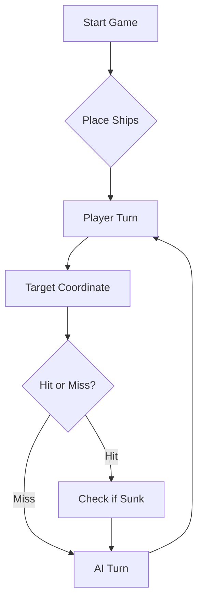

# ⚓ Battleship 2.0


> A modern take on the classic naval warfare game, designed for the XVII century setting with updated software engineering patterns.

---

## 📖 Table of Contents
- [Project Overview](#-project-overview)
- [Key Features](#-key-features)
- [Technical Stack](#-technical-stack)
- [Installation & Setup](#-installation--setup)
- [Code Architecture](#-code-architecture)
- [Roadmap](#-roadmap)
- [Contributing](#-contributing)

---

## 🎯 Project Overview
This project serves as a template and reference for students learning **Object-Oriented Programming (OOP)** and **Software Quality**. It simulates a battleship environment where players must strategically place ships and sink the enemy fleet.

### 🎮 The Rules
The game is played on a grid (typically 10x10). The coordinate system is defined as:

$$(x, y) \in \{0, \dots, 9\} \times \{0, \dots, 9\}$$

Hits are calculated based on the intersection of the shot vector and the ship's bounding box.

---

## ✨ Key Features
| Feature | Description | Status |
| :--- | :--- | :---: |
| **Grid System** | Flexible $N \times N$ board generation. | ✅ |
| **Ship Varieties** | Galleons, Frigates, and Brigantines (XVII Century theme). | ✅ |
| **AI Opponent** | Heuristic-based targeting system. | 🚧 |
| **Network Play** | Socket-based multiplayer. | ❌ |

---

## 🛠 Technical Stack
* **Language:** Java 17
* **Build Tool:** Maven / Gradle
* **Testing:** JUnit 5
* **Logging:** Log4j2

---

## 🚀 Installation & Setup

### Prerequisites
* JDK 17 or higher
* Git

### Step-by-Step
1. **Clone the repository:**
   ```bash
   git clone [https://github.com/britoeabreu/Battleship2.git](https://github.com/britoeabreu/Battleship2.git)
   ```
2. **Navigate to directory:**
   ```bash
   cd Battleship2
   ```
3. **Compile and Run:**
   ```bash
   javac Main.java && java Main
   ```

---

## 📚 Documentation

You can access the generated Javadoc here:

👉 [Battleship2 API Documentation](https://britoeabreu.github.io/Battleship2/)


### Core Logic
```java
public class Ship {
    private String name;
    private int size;
    private boolean isSunk;

    // TODO: Implement damage logic
    public void hit() {
        // Implementation here
    }
}
```

### Design Patterns Used:
- **Strategy Pattern:** For different AI difficulty levels.
- **Observer Pattern:** To update the UI when a ship is hit.
</details>

### Logic Flow


---

## 🗺 Roadmap
- [x] Basic grid implementation
- [x] Ship placement validation
- [ ] Add sound effects (SFX)
- [ ] Implement "Fog of War" mechanic
- [ ] **Multiplayer Integration** (High Priority)

---

## 🧪 Testing
We use high-coverage unit testing to ensure game stability. Run tests using:
```bash
mvn test
```

> [!TIP]
> Use the `-Dtest=ClassName` flag to run specific test suites during development.

---

## 🤝 Contributing
Contributions are what make the open-source community such an amazing place to learn, inspire, and create.

1. Fork the Project
2. Create your Feature Branch (`git checkout -b feature/AmazingFeature`)
3. Commit your Changes (`git commit -m 'Add some AmazingFeature'`)
4. Push to the Branch (`git push origin feature/AmazingFeature`)
5. Open a **Pull Request**

---

## 📄 License
Distributed under the MIT License. See `LICENSE` for more information.

---
**Maintained by:** [@britoeabreu](https://github.com/britoeabreu)  
*Created for the Software Engineering students at ISCTE-IUL.*


## Visualização gráfica do tabuleiro (Issue #2)

Contribuição do aluno 129890, com `com.formdev:flatlaf:3.7.2`.

Execute `battleship.Main` no IntelliJ e escreva `tabuleiro` na consola. A janela
apresenta a tua frota à esquerda e a frota inimiga à direita, partilhando a mesma
partida com a consola. Repetir `tabuleiro` volta a mostrar a mesma janela.
`gerafrota` e `lefrota` atualizam a frota na janela; `mapa`, `estado` e `tiros`
consultam essa mesma frota, incluindo os navios colocados com o rato.
`rajada A1 B2 C3` mantém o significado original: regista tiros **recebidos** na tua
frota. Para atacar o inimigo, selecione posições na grelha da direita.
`simula` mostra os tiros automáticos na tua frota. `desisto` fecha a sessão.
Também é possível executar `battleship.BoardWindow` diretamente, sem consola.

1. Escolha o tipo de navio e clique uma vez no tabuleiro esquerdo para colocar
   o navio inteiro. O número entre parênteses indica o tamanho; × indica quantos faltam.
   **Rodar** muda a orientação; a pré-visualização indica se a posição é válida.
   **Desfazer** retira o último navio. **Gerar frota** permite colocação automática.
   Uma posição inválida não coloca partes do navio nem apaga os já colocados.
2. Coloque os 11 navios: 4 barcas, 3 caravelas, 2 naus, 1 fragata e 1 galeão em T.
   Mantêm-se as regras do motor original: os navios não se podem tocar.
3. Clique em **Começar partida**. A frota inimiga fica escondida.
4. Selecione três posições na grelha inimiga e clique em **Disparar rajada**.
   Clique novamente numa seleção para a retirar. O computador responde com
   uma rajada aleatória, sem consultar a posição dos navios do jogador.
5. O cinzento representa navios; cruzes vermelhas representam acertos; círculos
   em azul escuro representam tiros na água. As estatísticas atualizam-se por turno.
6. **Nova partida** reinicia o tabuleiro. As vitórias são contabilizadas apenas
   durante a sessão atual, sem armazenamento permanente.

Não é permitido voltar a selecionar posições já atingidas. Na última rajada,
se restarem menos de três posições, o adaptador repete a última posição apenas
para respeitar o formato de três tiros exigido pelo motor original.
O adversário gráfico é local e aleatório, não é o LLM das partes C e D da ficha.
O modo de consola continua disponível através de `battleship.Main`.
O mesmo relógio mede as jogadas da consola e da janela: começa com a frota pronta,
regista o tempo ao disparar e reinicia para a jogada seguinte. Uma nova frota
reinicia a contagem; desfazer a colocação ou iniciar uma nova partida fecha o relógio.

Execute `mvn test` para correr os testes. O teste Swing é omitido em ambientes
sem interface gráfica; os testes de colocação, turnos e estados continuam a executar.

Issue: https://github.com/LEI-129880/Battleship2/issues/2
